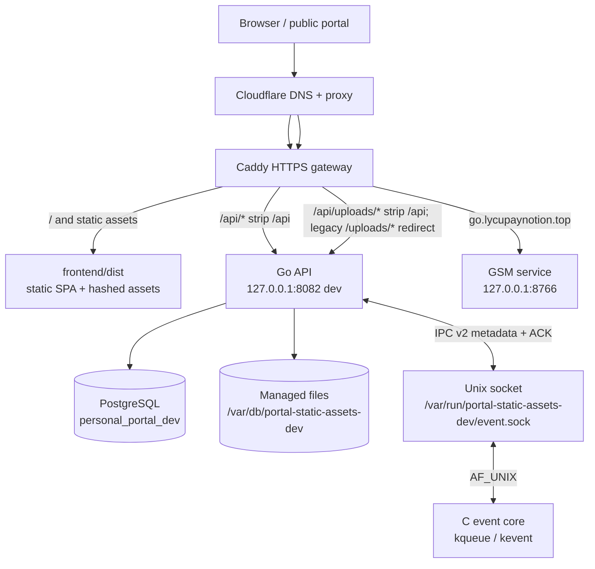
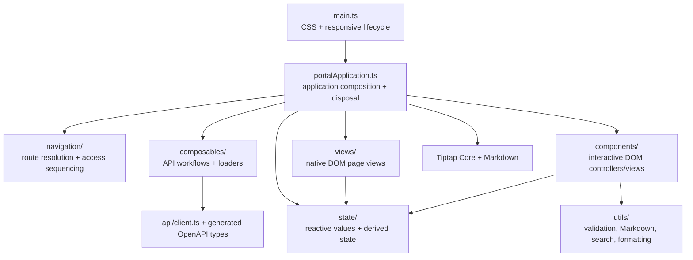
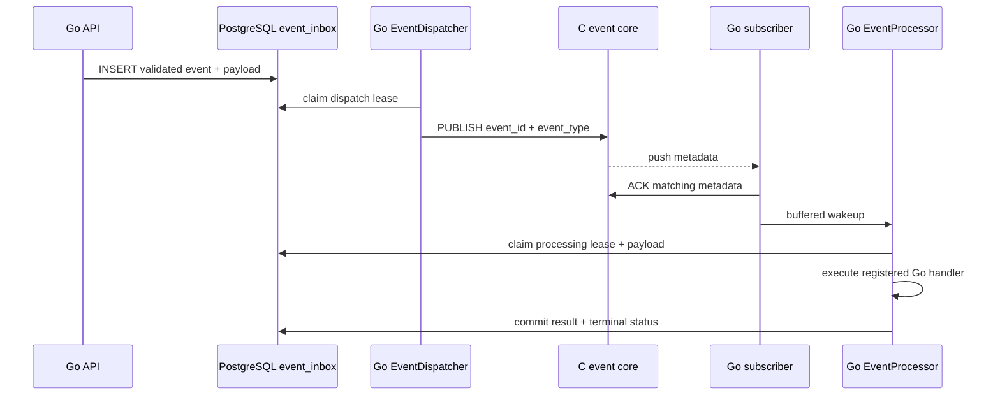

# Personal Portal — System Architecture Map

**Status:** development architecture baseline, 2026-10-31. This document describes the repository and the isolated public development runtime; it is not a production deployment record. Reconcile it with source and deployment templates whenever a boundary changes.

## 1. Runtime topology

The public hostname currently serves the development build. Caddy is the only public HTTP entry point; the Go API and event core bind only to loopback/Unix socket. The GSM hostname is a separate service and is not part of the portal API process.

### Development runtime paths

| Component | Development value |
|---|---|
| Repository | `/opt/portal-static-assets` |
| Frontend output | `/opt/portal-static-assets/frontend/dist` |
| Go API | `/usr/local/libexec/portal-static-assets-dev/api` |
| API listener | `127.0.0.1:8082` |
| C event core | `/usr/local/libexec/portal-static-assets-dev/event-core` |
| Event socket | `/var/run/portal-static-assets-dev/event.sock` |
| Database | `personal_portal_dev` |
| Database URL file | `/usr/local/etc/portal-static-assets-dev/database-url` |
| Upload images | `/var/db/portal-static-assets-dev/uploads` |
| Teaching resources | `/var/db/portal-static-assets-dev/resources` |
| Runtime user | `personalportal` |
| Registration | disabled (`PERSONAL_PORTAL_REGISTRATION_ENABLED=0`) |

The production deployment template is deliberately separate: `deploy/freebsd/Caddyfile` and `deploy/freebsd/deploy.sh` target the production Go listener on `127.0.0.1:8081`, production database name `personal_portal`, and production release directories. The development deploy path is `deploy/freebsd/deploy-dev.sh`; never substitute the production deploy script for it.

## 2. Frontend module boundaries

- `main.ts` is the browser entry. It initializes responsive policy handling, mounts the application, and owns the top-level disposer used by HMR.
- `portalApplication.ts` composes app-wide state, route guards, lazy module loading, view mounts, and teardown. It is an orchestration module, not the owner of server authorization.
- `navigation/` resolves URL state and sequences navigation; `composables/` owns reusable API workflows; `state/` owns reactive state contracts and stateful controllers.
- `views/` and `components/` render native DOM and own their listeners/DOM lifecycles. The current frontend has no Vue SFC files; it uses TypeScript modules, framework-neutral DOM mounting, `@preact/signals-core` state primitives, and Tiptap Core.
- `api/generated` is generated from `api/openapi.yaml`; do not hand-edit generated API types.
- `utils/` contains reusable pure functions and bounded side-effect helpers. `config/` contains static route/category/table configuration.

## 3. Go API module boundaries

| Module group | Main files | Responsibility |
|---|---|---|
| Process and HTTP entry | `main.go`, `portal_api.go`, `http_helpers.go` | Process lifecycle, HTTP server, database pool, route dispatch, shared response/JSON helpers |
| Authentication | `auth_api.go`, `rate_limit.go` | Session lookup, cookie lifecycle, login/register/logout, client-IP rate limiting |
| RBAC | `rbac_api.go`, `user_role_management.go`, `role_permission_management.go` | Super-admin-gated role and permission administration |
| Content | `content_api.go`, `content_validation.go`, `content_input_validation.go`, `content_versions.go`, `image_references.go` | Owner-scoped content CRUD, publish/unpublish, validation, versions, trash, managed-image reference locks |
| Resources/files | `resource_api.go`, `resource_files.go`, `image_api.go`, `managed_files.go`, `file_cleanup.go` | Owner-scoped teaching resources, uploads, previews/downloads, confined filesystem access, durable cleanup events |
| Public read paths | `public_api.go` | Public content/resources, search, article interactions |
| Compliance | `compliance_api.go`, `compliance_assets.go`, `compliance_catalog.go`, `compliance_evidence_verification.go` | License/asset records, evidence verification, review state and audit |
| System operations | `system_ops.go`, `system_logs.go`, `metrics_api.go` | Read-only warnings/logs/streaming and database-derived metrics; no command-task execution |
| Durable events | `event_ingress.go`, `event_dispatcher.go`, `event_processor.go`, `event_processor_store.go` | Event validation, PostgreSQL persistence, leases, dispatch, retries and handlers |
| IPC client | `ipc_client.go` | Bounded IPC v2 requests, push acknowledgement and reconnect |

`portalAPI.ServeHTTP` is the HTTP route boundary. It dispatches to domain handlers; each protected handler calls `requireUser` and then applies owner or permission checks. PostgreSQL constraints and row-scoped predicates remain authoritative; frontend visibility is not authorization.

## 4. Critical request and data flows

### Authentication and protected routes

1. Browser sends same-origin `/api/auth/*` request; Caddy strips `/api` before forwarding.
2. Go reads the HttpOnly, Secure, SameSite=Strict `portal_session` cookie and hashes the opaque token before querying `portal.portal_auth_sessions`.
3. Session expiry and user identity are resolved from PostgreSQL. Protected handlers call `requireUser`; administrative handlers add RBAC/super-admin checks.
4. Registration is a deployment capability and is disabled in the current development runtime. Re-enable only as an explicit, separately reviewed decision.

### Content and resource ownership

1. Authenticated writes are decoded with size limits and strict JSON validation.
2. Content operations constrain queries/mutations by `author_id`; teaching-resource operations constrain by `owner_id`.
3. Public read endpoints select only published/public records. Private file/image access is owner-gated; public uploaded images require a reference from published public content.
4. Managed filenames are single path components. `os.Root`-based open/write/remove operations prevent traversal outside the configured directory. Uploaded files are not served directly by Caddy.
5. Permanent deletion commits database changes and a cleanup event together; the event processor removes the managed file. A missed IPC wakeup is recovered by PostgreSQL polling.
6. Content create/update/version restore and permanent image deletion acquire the same PostgreSQL transaction advisory lock per managed filename, in sorted order. New bodies must reference a registered image. Cleanup checks both current `portal_content.body` and every restorable `portal_content_versions.snapshot.body`; an image with any remaining reference is retained.

### Durable event lifecycle

PostgreSQL is the durable source of truth. C carries only bounded event metadata; its in-memory FIFO is a wakeup optimization, not a durable queue. `PUBLISHED` and `ACKNOWLEDGED` do not prove business completion. The Go processor claims work independently and periodic recovery handles lost/duplicate notifications.

## 5. Trust boundaries and security invariants

- Cloudflare proxy ranges and `CF-Connecting-IP` are configured at Caddy. Caddy supplies `X-Portal-Client-IP`; Go trusts that header only when the peer is loopback. Generic `X-Forwarded-For` is ignored.
- Caddy strips `/api` for API routes. Image reads use `/api/uploads/*`, with only `/api` stripped before Go's `/uploads/*` ownership gate; legacy `/uploads/*` URLs redirect to the API-prefixed path so the browser sends the `Path=/api` session cookie. Static fallback must never answer upload paths.
- `/api/events`, `/api/dbz`, `/api/readyz`, and `/api/metrics` are blocked at the public gateway; these endpoints remain loopback-only operational surfaces.
- The Go API and C event core run as `personalportal`, not root. The C Unix socket is mode `0600`; C does not listen on TCP.
- Runtime database role is least-privilege `personal_portal_app`; schema ownership is separated into non-login `personal_portal_owner`.
- User-facing content/resource access is owner-scoped in SQL. Super-admin controls are server-enforced; frontend role visibility is not a security control. Compliance read/write access is granted only by `portal_user_roles` + `role_permissions`; the legacy `portal_users.is_admin` compatibility flag alone must never bypass the permission matrix.
- Managed image references are serialized by PostgreSQL transaction advisory locks across content creation/update/version restore and permanent deletion. Cleanup must account for current bodies and restorable historical snapshots before removing image registration or files.
- Uploaded image and resource paths are confined by `os.Root`. Caddy must proxy uploads to Go, never `file_server` the managed upload directory.
- The privileged command-task executor and its database tables/permission have been retired by migration 031. No root worker or command-execution API is part of the current architecture.
- Public registration is disabled in the current development runtime. Development and production databases, binaries, paths and Caddy templates remain separate.

## 6. Verification coverage and remaining limits

| Boundary | Current automated evidence | Remaining limit |
|---|---|---|
| Frontend native views/state | 103/103 Node/jsdom tests; TypeScript check and Vite build | Not a substitute for visual/accessibility checks across every browser/assistive technology |
| Go contracts | `go test -race`, `go vet`; JSON/rate-limit/IPC bounds, definite file-insert failure cleanup, and ambiguous image/resource create commit preservation tests | Race tests do not prove production traffic behavior; preserved files after a genuinely rolled-back ambiguous commit still require reconciliation |
| PostgreSQL | Full migrations 001–031 on disposable DB; integration tests for RBAC read/write matrix, content/resource ownership, image privacy/public reference, historical-version image retention, both advisory-lock race orderings, resource replacement cleanup, event leases | Restore drill and sustained production-like load are separate work |
| C event core | Protocol unit tests plus live kqueue socket tests for 64-client cap, framing, timeout, ACK, SIGTERM cleanup and restart | No long-duration soak or production-load benchmark yet |
| Go/C integration | Native integration test launches C, receives/ACKs pushes, restarts C and verifies Go reconnect | CI native coverage is platform-runner-specific; not a cross-platform kqueue guarantee |
| Public gateway | Caddy config validation; local-origin checks for routes, headers, internal endpoint isolation, registration closure and upload 404 | External Cloudflare edge behavior should be rechecked after any DNS/proxy policy change |
| Deployment | Development backup and `pg_restore -l`; isolated dev runtime and Caddy configuration; public Cloudflare DNS path checks | Formal production release not performed; full database restore has not yet been rehearsed |

### Open work before declaring phase 2 complete

1. Complete authenticated browser flows against the public development hostname: image upload, private owner-only access, public referenced-image access, teaching-resource download and cleanup. Public unauthenticated routing and health gates are verified; this authenticated live-browser pass remains open.
2. Finish the remaining backend authorization/error-path audit and decide whether large domain files should be split based on call-graph and test boundaries, not line count alone.
3. Completed: deterministic PostgreSQL tests cover historical-version image retention, both concurrent create/delete lock orderings, and resource replacement cleanup. Reopen only if new evidence identifies another orphan/lost-update case.
4. The repository-wide architecture/data-flow map is recorded in this document; complete the separate risk register in Notion and reconcile it against the final source tree.
5. Complete second-stage acceptance checks and a documented recovery drill before any separate production-release decision.

The development deployment does not mark phase 2 complete and does not authorize a production release.
